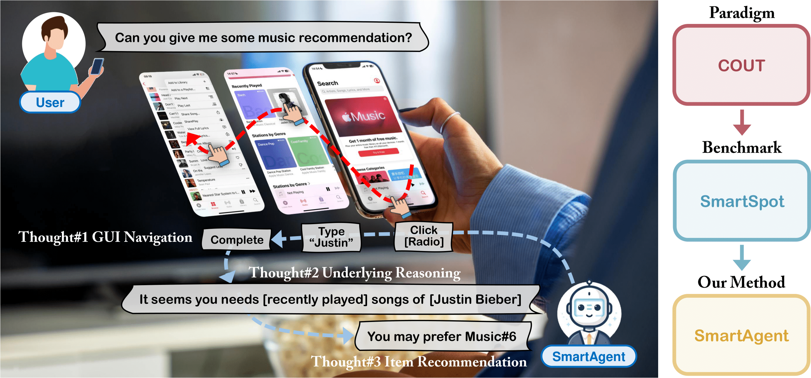
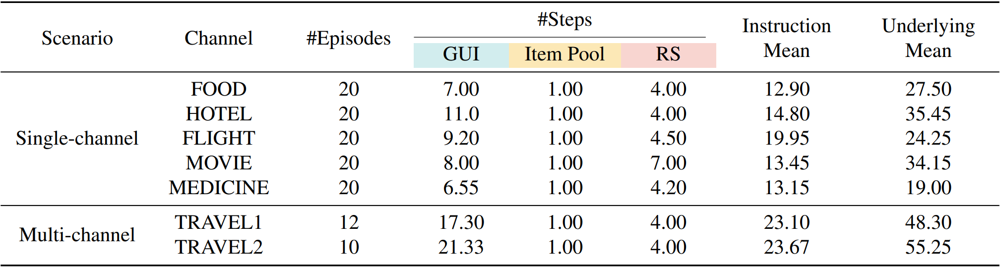

<p align="center" width="100%">
  
</p>


# [AAAI 2026]  SmartAgent: Chain-of-User-Thought for Embodied Personalized Agent in Cyber World
The official repository of our paper "[SmartAgent: Chain-of-User-Thought for Embodied Personalized Agent in Cyber World](https://ojs.aaai.org/index.php/AAAI/article/view/38859)". 

# Blogs 🤗 
- Find SmartAgent in [Awesome-LLM-Reasoning](https://github.com/atfortes/Awesome-LLM-Reasoning) [](https://github.com/atfortes/Awesome-LLM-Reasoning) with more brilliant works on LLM/MLLM reasoning!
- Find SmartAgent in [Multimodal Chain-of-Thought Reasoning: A Comprehensive Survey](https://arxiv.org/pdf/2503.12605) [](https://github.com/yaotingwangofficial/Awesome-MCoT) with the latest Multimodal CoT reasoning techniques toward multimodal AGI!
- Find SmartAgent in [Agentic Web: Weaving the Next Web with AI Agents](https://github.com/SafeRL-Lab/agentic-web) [](https://github.com/SafeRL-Lab/agentic-web) opening opportunities and challenges of intelligence, interaction, and economics for the next-generation web technologies!
- Find SmartAgent in [LLM-Agent-for-Recommendation-and-Search](https://arxiv.org/pdf/2503.05659) [](https://github.com/tsinghua-fib-lab/LLM-Agent-for-Recommendation-and-Search) with more fascinating LLM agents inspiring the next-generation information retrieval!

# Chain-of-User-Thought (COUT) Reasoning Paradigm
We formulate COUT to achieve embodied personalized agent training in terms of three stages of thought. In Thought #1, according to a user's instruction, an agent performs GUI actions to search for an item pool. In Thought #2 with seeing the pool, the agent reasons underlying requirements behind the original instruction, as implied by the previous actions. In Thought #3, based on the underlying thought, the agent recommends items within the pool to complete the user's instruction. 

<p align="center" width="100%">
  
</p>


# SmartSpot Benchmark

## Download Link
- Google Drive: [image data](https://drive.google.com/file/d/1LCXAxkhVRnHLh1e5TK3L_nzDym3qZa2b/view?usp=drive_link), [annotation data (zh)](https://drive.google.com/file/d/16Q7pa5ifgkmiLJ6x6qN0CuF1aLyNP72l/view?usp=drive_link), [annotation data (en)](https://drive.google.com/file/d/1tmVyjdjKPFJt3bPMqpcvCL4iwmZ5G3J4/view?usp=drive_link).
## Datasets Statistics
<p align="center" width="100%">
  
</p>

## Requirements

Install the Python dependencies:

```bash
pip install -r requirements.txt
```

# Run SmartAgent

## Data Preprocessing

```bash
python process.py
```

## Training

```bash
bash run.sh
```

## Evaluation

```bash
python test.py
```

## Convert LoRA Checkpoints

```bash
python resave_ckpt.py
```


# Citation
Please consider citing our paper and staring this repo if you find SmartAgent helpful in your work, thanks!

```bib
@inproceedings{zhang2026smartagent,
  title={Smartagent: Chain-of-user-thought for embodied personalized agent in cyber world},
  author={Zhang, Jiaqi and Gao, Chen and Zhang, Liyuan and Nguyen, Quoc Viet Hung and Yin, Hongzhi},
  booktitle={Proceedings of the AAAI Conference on Artificial Intelligence},
  volume={40},
  number={21},
  pages={17993--18001},
  year={2026}
}
```
